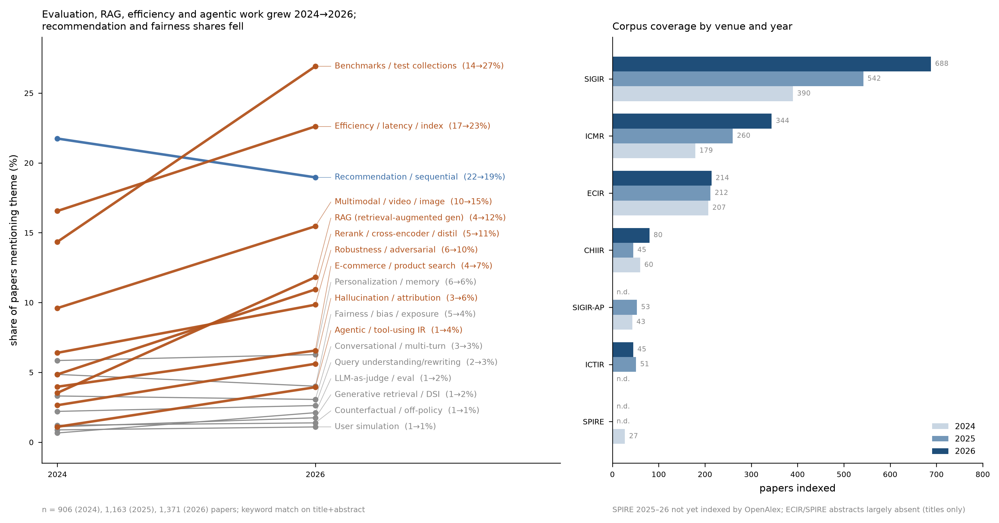

# Semester project ideas for CS4406 — grounded in SIGIR / CHIIR / ECIR / ICTIR / ICMR / SPIRE, 2024–2026

## What this is built on

I indexed **3,440 papers** from the 2024, 2025 and 2026 editions of SIGIR, SIGIR-AP, ECIR, CHIIR, ICTIR, ICMR and SPIRE via OpenAlex, reconstructed abstracts where available, and tagged them against 25 topic patterns to see what the field is actually moving toward. The corpus and the tagged trend table are saved alongside this document.

Two caveats on coverage, stated up front because they affect how much weight to put on the numbers:

- **ECIR and SPIRE abstracts are almost entirely missing** from OpenAlex (1% and 4% coverage respectively), so those venues are tagged on titles alone and their theme shares are understated. ACM venues have 86–95% abstract coverage.
- **SPIRE 2025 and 2026 are not yet indexed.** SPIRE is also the least relevant of the six for these project types — it skews toward string algorithms and compressed data structures rather than systems-level IR.

Direct scraping of the ACM DL, DBLP, Crossref and Semantic Scholar was blocked from this environment; OpenAlex was the one reachable source, so proceedings were reconstructed by resolving each conference's per-year DOI prefix and paging every paper under it.

**What the trend data says.** Between 2024 and 2026 the shares that grew are: benchmarks and test collections (14%→27%), RAG (4%→12%), reranking and distillation (5%→11%), efficiency and latency (17%→23%), multimodal retrieval (10%→15%), robustness and adversarial work (6%→10%), hallucination and attribution (3%→6%), and agentic/tool-using IR (1%→4%). The shares that fell are recommendation (22%→19%) and fairness (5%→4%). Industry-affiliated papers held steady at roughly 10% of the corpus across all three years.

The pattern is consistent: the field has moved from *building better rankers* to *measuring, bounding and paying for* systems that already work well enough. That is good news for a 4-month project, because measurement studies are far more finishable than system-building ones and the course explicitly rewards rigor over breadth.

---

## How I selected these

Every idea below satisfies five constraints:

1. It fits the course's project shape — a well-posed question, at least two competing implementations, ablations, an offline or simulated A/B evaluation, and a discussion of scaling, cost and failure modes.
2. It rests on **public data** you can get in week 1, so no semester is lost to data access.
3. It is a *measurement or comparison* study, not a system build, so the deliverable exists even if the interesting arm loses.
4. A negative result is publishable within the project — the course says the bar is the difficulty of the question, not the size of the win.
5. Someone in industry has the same problem this semester.

Each idea lists a headline question, why it matters now, the specific gap in the 2024–2026 literature, the arms to implement, data, evaluation protocol, ablations, the cost analysis, risk, and team size. Reading lists are in the accompanying CSV.

---

## P1. Selective LLM relevance judging under an annotation budget

*Closest to the course's RAG-evaluation-harness idea, but scoped to the judgment layer.*

**Question.** Given a fixed budget of B human judgments per topic, which *selection policy* for deciding which query-document pairs to send to a human (vs. an LLM assessor) maximizes the fidelity of the resulting system ranking?

**Why now.** LLM-as-judge went from 0.7% to 2.1% of papers 2024→2026 and 'benchmarks / test collections' is the single fastest-growing theme (14%→27%). The open question in that literature is not *can LLMs judge* — it's *where do you spend the human budget*. Every company running an offline eval loop has this exact budget problem.

**The gap.** Takehi et al. and Farzi & Dietz both propose selection or criteria-decomposition schemes, but they are evaluated on different collections with different assessors, and nobody compares selection policies head-to-head under a matched budget with a system-ranking-fidelity metric.

**Arms to implement.**

- Random sampling
- Uncertainty-based (LLM judge self-consistency / entropy across k samples)
- Disagreement-based (two different LLM judges disagree)
- Pool-depth-based (top-k of the fusion pool only)
- Criteria-decomposition (judge sub-criteria, escalate only conflicts)

**Data.** TREC DL 2019–2023 (MS MARCO) qrels as the human gold standard; simulate the budget by revealing NIST judgments only for pairs your policy selects. Optionally TREC RAG 2024 for a second collection.

**Evaluation.** Primary: Kendall's τ and rank-biased overlap between the system ranking induced by your budgeted qrels and the ranking induced by full NIST qrels, across ~30–50 TREC runs. Secondary: per-topic nDCG@10 error. Bootstrap CIs over topics. Report the budget–fidelity curve, not a single point.

**Ablations.**

- judge model size (small open-weight vs. frontier)
- prompt variant (binary vs. graded vs. UMBRELA-style)
- budget B ∈ {5, 10, 25, 50, 100} per topic
- hold out one TREC year to check the policy transfers

**Cost / scaling analysis.** Judge-token cost per topic vs. fidelity — the actual industry decision. Report $/topic and wall-clock.

**Risk.** Low. Data is public and small. Main risk is LLM API cost — cap it by using a small open-weight judge for the bulk arms.

**Scope.** Small — 2 people, mostly prompting + statistics. Compute: CPU + modest API budget.

**Anchor reading.**

- Arabzadeh & Clarke (SIGIR 2025) — *Benchmarking LLM-based Relevance Judgment Methods* — [doi:10.1145/3726302.3730305](https://doi.org/10.1145/3726302.3730305)
- Takehi et al. (SIGIR 2025) — *LLM-Assisted Relevance Assessments: When Should We Ask LLMs for Help?* — [doi:10.1145/3726302.3729916](https://doi.org/10.1145/3726302.3729916)
- Fröbe et al. (SIGIR 2025) — *Large Language Model Relevance Assessors Agree With One Another More Than With Human Assessors* — [doi:10.1145/3726302.3730218](https://doi.org/10.1145/3726302.3730218)
- Otero et al. (SIGIR 2025) — *Limitations of Automatic Relevance Assessments with Large Language Models for Fair and Reliable Retrieval Evaluation* — [doi:10.1145/3726302.3730221](https://doi.org/10.1145/3726302.3730221)
- Upadhyay et al. (ICTIR 2025) — *A Large-Scale Study of Relevance Assessments with Large Language Models Using UMBRELA* — [doi:10.1145/3731120.3744605](https://doi.org/10.1145/3731120.3744605)
- Farzi & Dietz (SIGIR 2025) — *Does UMBRELA work on other LLMs?* — [doi:10.1145/3726302.3730317](https://doi.org/10.1145/3726302.3730317)
- Farzi & Dietz (ICTIR 2025) — *Criteria-Based LLM Relevance Judgments* — [doi:10.1145/3731120.3744591](https://doi.org/10.1145/3731120.3744591)
- Mohtadi et al. (ECIR 2026) — *The Effect of Document Summarization on LLM-Based Relevance Judgments* — [doi:10.1007/978-3-032-21300-6_5](https://doi.org/10.1007/978-3-032-21300-6_5)
- Thakur et al. (SIGIR 2025) — *Assessing Support for the TREC 2024 RAG Track: A Large-Scale Comparative Study of LLM and Human Evaluations* — [doi:10.1145/3726302.3730165](https://doi.org/10.1145/3726302.3730165)
- Rahmani et al. (SIGIR 2024) — *Synthetic Test Collections for Retrieval Evaluation* — [doi:10.1145/3626772.3657942](https://doi.org/10.1145/3626772.3657942)

---

## P2. A nugget-based RAG evaluation harness that is cheap enough to run in CI

*This is the course's 'RAG evaluation harness' idea, sharpened by what SIGIR 2025–26 actually published.*

**Question.** Can a nugget bank be compressed (fewer, better nuggets) without changing the *system ordering* it produces — and what is the compression/fidelity frontier?

**Why now.** Nugget-based evaluation is now the de facto standard for RAG report evaluation (TREC RAG, Auto-ARGUE), but a full nugget bank is expensive to build and to score. Dietz et al. (SIGIR 2026) explicitly raise the 'too many questions' problem. An eval you can afford to run on every model change is a different product from one you run once a year.

**The gap.** Nugget-bank construction and nugget-scoring are studied separately; the *cost* axis is rarely reported, and nobody has published the compression-vs-system-ordering-fidelity curve.

**Arms to implement.**

- Full nugget bank (reference)
- Frequency-pruned bank (drop nuggets few systems hit — low discriminative power)
- Clustered/deduplicated bank (embed nuggets, merge near-duplicates)
- LLM-summarized bank (ask the judge to merge)
- Random subsample at matched size (the honest baseline everyone skips)

**Data.** TREC RAG 2024/2025 topics + released runs, or Researchy Questions if you want harder, multi-perspective queries.

**Evaluation.** System-ordering fidelity (τ, RBO) vs. full bank; per-system score error; judge-token cost per topic. Bootstrap over topics.

**Ablations.**

- nugget granularity (atomic fact vs. sentence)
- assignment strictness (strict entailment vs. loose)
- judge model swap
- the 'insider knowledge' check from Dietz et al. — does a system that saw the nugget bank game it?

**Cost / scaling analysis.** $/topic and seconds/topic at each compression level; project to 'cost of one CI run on 500 topics'.

**Risk.** Low-medium. Depends on TREC RAG run files being available; if not, generate 6–8 RAG systems yourself (different retrievers × generators) and evaluate those.

**Scope.** Small–medium — 2–3 people. CPU + API budget.

**Anchor reading.**

- Pradeep et al. (SIGIR 2025) — *The Great Nugget Recall: Automating Fact Extraction and RAG Evaluation with Large Language Models* — [doi:10.1145/3726302.3730090](https://doi.org/10.1145/3726302.3730090)
- Dietz et al. (SIGIR 2026) — *Too Many Questions: Deriving Concise and Effective Nugget Banks* — [doi:10.1145/3805712.3809981](https://doi.org/10.1145/3805712.3809981)
- Walden et al. (SIGIR 2026) — *Auto-ARGUE: LLM-Based Report Generation Evaluation* — [doi:10.1145/3805712.3808384](https://doi.org/10.1145/3805712.3808384)
- Farzi et al. (SIGIR 2026) — *Auto-Judge: A Cross-Task Benchmark for Comparing LLM Judges for Citation-Grounded RAG Systems* — [doi:10.1145/3805712.3808601](https://doi.org/10.1145/3805712.3808601)
- Wallat et al. (ICTIR 2025) — *Correctness is not Faithfulness in Retrieval Augmented Generation Attributions* — [doi:10.1145/3731120.3744592](https://doi.org/10.1145/3731120.3744592)
- Dietz et al. (ECIR 2026) — *Insider Knowledge: How Much Can RAG Systems Gain from Evaluation Secrets?* — [doi:10.1007/978-3-032-21289-4_37](https://doi.org/10.1007/978-3-032-21289-4_37)
- Gienapp et al. (SIGIR 2025) — *The Viability of Crowdsourcing for RAG Evaluation* — [doi:10.1145/3726302.3730093](https://doi.org/10.1145/3726302.3730093)
- Zerhoudi et al. (SIGIR 2026) — *NuggetIndex:  Governed Atomic Retrieval for Maintainable RAG* — [doi:10.1145/3805712.3809687](https://doi.org/10.1145/3805712.3809687)

---

## P3. A standing-query scout: when is a re-run worth the cost?

*Directly the course's 'standing-query scouting agent' idea, made measurable.*

**Question.** For a persistent information need over an evolving corpus, what is the optimal *re-execution policy* — when to re-run the query, and when to notify — under a fixed compute budget and a notification-fatigue penalty?

**Why now.** Efficiency/latency work is 23% of 2026 papers, and freshness is showing up industrially (Snapchat trend detection, dynamic content expiration prediction at web scale). Every alerting product, patent watch, and competitive-intel tool is this problem, and almost nobody frames it as a decision problem with an explicit cost.

**The gap.** LongEval gives you the temporal collection; the streaming-retrieval literature gives you the index mechanics; the stopping-rule literature (Fletcher & Stevenson) gives you the decision theory. Nobody has combined them into a policy evaluated on a real temporal collection with an explicit cost model.

**Arms to implement.**

- Fixed-interval re-run (daily/weekly)
- Corpus-drift-triggered (re-run when the incoming batch's embedding distribution shifts past a threshold)
- Query-specific volatility model (learn per-query how fast its result set churns)
- Decision-theoretic stopping rule (expected utility of re-run vs. cost)

**Data.** LongEval CLEF collections (temporally sliced web corpus with per-slice qrels) — the one collection built exactly for this. Fallback: build your own temporal slices from a news or arXiv dump.

**Evaluation.** Simulated A/B over the time axis: for each policy, measure (a) freshness regret — nDCG gap vs. an oracle that re-runs every slice, (b) number of re-runs (compute cost), (c) notifications sent vs. genuinely-new relevant documents (precision of alerting). Pareto plot of regret vs. cost. Bootstrap over queries.

**Ablations.**

- drift-detection statistic (MMD vs. centroid shift vs. new-term rate)
- notification threshold
- index type (BM25 vs. dense — dense drifts differently)
- one 'shock' slice with a burst of new content

**Cost / scaling analysis.** Re-runs/query/month × index cost; this is the whole point of the project.

**Risk.** Medium — depends on getting LongEval data (it is available through CLEF; request early, week 1).

**Scope.** Medium — 2–3 people. CPU-heavy, no GPU strictly needed.

**Anchor reading.**

- Breuer et al. (ECIR 2026) — *Evaluating Information Retrieval Models Along Time: The LongEval Lab at CLEF 2026* — [doi:10.1007/978-3-032-21321-1_45](https://doi.org/10.1007/978-3-032-21321-1_45)
- Cancellieri et al. (ECIR 2025) — *LongEval at CLEF 2025: Longitudinal Evaluation of IR Model Performance* — [doi:10.1007/978-3-031-88720-8_58](https://doi.org/10.1007/978-3-031-88720-8_58)
- Chen et al. (SIGIR 2026) — *RAG-Enhanced Large Language Models for Dynamic Content Expiration Prediction in Web Search* — [doi:10.1145/3805712.3808457](https://doi.org/10.1145/3805712.3808457)
- Zhao et al. (SIGIR 2026) — *LLM-Enhanced Topical Trend Detection at Snapchat* — [doi:10.1145/3805712.3808475](https://doi.org/10.1145/3805712.3808475)
- Nishikawa et al. (SIGIR 2026) — *Recasting Web-Scale Query Suggestion as  dense retrieval:  Efficient, Up-to-Date, and Context-Aware Suggestions* — [doi:10.1145/3805712.3809694](https://doi.org/10.1145/3805712.3809694)
- Fletcher & Stevenson (SIGIR 2026) — *Decision-Theoretic Stopping Rules for Document Screening* — [doi:10.1145/3805712.3809548](https://doi.org/10.1145/3805712.3809548)
- Lawrie et al. (SIGIR 2024) — *PLAID SHIRTTT for Large-Scale Streaming Dense Retrieval* — [doi:10.1145/3626772.3657964](https://doi.org/10.1145/3626772.3657964)

---

## P4. How much memory does a conversational agent actually need?

*The course's 'agentic memory' idea, turned into an ablation study rather than a system build.*

**Question.** Across a long multi-session information-seeking dialogue, what is the retrieval-quality return per token of retained memory, and which memory representation gives the best curve?

**Why now.** Two SIGIR 2026 papers (Efficient Memory Alignment, Dynamic Memory Forest) propose memory architectures; a third (Do Simulated Users Need to Remember?) asks the mirror question on the user side. Every deployed assistant pays for memory in context tokens, so the return-per-token curve is the number a product team needs.

**The gap.** Memory architectures are proposed and beaten against a no-memory baseline. The token-budget frontier — 'at 2k tokens of memory, which representation wins?' — is not published.

**Arms to implement.**

- Raw truncated history (last-k turns)
- Extractive summary
- Structured user profile (slots: entities, preferences, constraints)
- Vector memory over past turns, retrieved per query
- Hybrid: profile + retrieved episodic snippets

**Data.** TREC iKAT 2023/2024/2025 (personalized conversational search with PTKB — personal knowledge base — exactly this setting). Optionally MultiWOZ-style or LongMemEval as a second surface.

**Evaluation.** nDCG@3 / recall on the retrieval step at fixed memory-token budgets {0, 256, 512, 1k, 2k, 4k}. Plot quality vs. memory tokens. Per-turn latency and cost. Bootstrap over conversations. Split by turn depth — memory should matter more at turn 8 than turn 2, and showing that is a result.

**Ablations.**

- memory write policy (every turn vs. only on new entity)
- forgetting (recency decay, capacity cap)
- how gracefully each representation degrades when a turn is dropped

**Cost / scaling analysis.** Context tokens/turn × turns — direct serving cost. Note the privacy angle (Salemi & Zamani).

**Risk.** Low-medium. iKAT data is available; the work is careful engineering + measurement.

**Scope.** Medium — 2–3 people.

**Anchor reading.**

- Xu et al. (SIGIR 2026) — *Efficient Memory Alignment for Long-term Conversational Information Seeking* — [doi:10.1145/3805712.3809926](https://doi.org/10.1145/3805712.3809926)
- Ke et al. (SIGIR 2026) — *Dynamic Memory Forest: Constructing and Tracing Conversational Trajectories for Long-Term Conversation* — [doi:10.1145/3805712.3809646](https://doi.org/10.1145/3805712.3809646)
- Mirzakhmedova et al. (SIGIR 2026) — *Do Simulated Users Need to Remember? Analyzing the Impact of Memory Models in Conversational Search Evaluation* — [doi:10.1145/3805712.3809556](https://doi.org/10.1145/3805712.3809556)
- Abbasiantaeb et al. (SIGIR 2025) — *Conversational Gold: Evaluating Personalized Conversational Search System Using Gold Nuggets* — [doi:10.1145/3726302.3730316](https://doi.org/10.1145/3726302.3730316)
- Abbasiantaeb et al. (SIGIR 2026) — *TREC iKAT 2025: A Test Collection for the Offline and Interactive Evaluation of Conversational Search* — [doi:10.1145/3805712.3808591](https://doi.org/10.1145/3805712.3808591)
- Abbasiantaeb et al. (ECIR 2025) — *Improving the Reusability of Conversational Search Test Collections* — [doi:10.1007/978-3-031-88708-6_13](https://doi.org/10.1007/978-3-031-88708-6_13)
- Salemi & Zamani (ICTIR 2025) — *Comparing Retrieval-Augmentation and Parameter-Efficient Fine-Tuning for Privacy-Preserving Personalization of Large Language Models* — [doi:10.1145/3731120.3744595](https://doi.org/10.1145/3731120.3744595)

---

## P5. Generative retrieval under index churn

*The course's 'lightweight generative-retrieval study', with the failure mode that actually blocks deployment.*

**Question.** When documents are continuously added to the corpus, how does generative retrieval (docid generation) degrade relative to dense and sparse retrieval, and which update strategy recovers the most quality per unit of re-training compute?

**Why now.** Generative retrieval's fatal industrial objection is that the index lives in model weights, so new documents require re-training. Three papers in the last two SIGIRs attack exactly this (Replication over Dynamic Corpora, Efficient Continual Adaptation, Parametric Memory Head). It's a well-posed question with a clear negative-result path — which the course explicitly allows.

**The gap.** Each paper proposes one update mechanism on one setup. There is no controlled comparison of update strategies at matched compute against a dense-retrieval baseline that just adds vectors for free.

**Arms to implement.**

- Full re-training on the grown corpus (upper bound, expensive)
- Incremental fine-tuning on new docs only (measure catastrophic forgetting)
- Parametric memory head / adapter for new docs
- Hybrid: generative for the stable core + dense index for the new tail
- Dense retrieval baseline (adding to an ANN index is nearly free — this is the arm that may just win)

**Data.** MS MARCO or NQ, split temporally or by a synthetic arrival schedule (e.g., 10 batches of 10% each). Use a small T5/BART-scale model — this must fit a student budget.

**Evaluation.** nDCG@10 / MRR on (a) old documents, (b) new documents, separately — the forgetting/plasticity split is the whole story. Plot quality vs. cumulative training FLOPs. Bootstrap over queries.

**Ablations.**

- docid scheme (atomic, semantic codebook, C2T-ID-style textual)
- arrival rate (few big batches vs. many small)
- corpus growth ratio (2× vs. 10×)

**Cost / scaling analysis.** GPU-hours per index update vs. dense re-encoding cost. State the crossover point.

**Risk.** Medium — needs a GPU. Keep the model small (T5-base) and the corpus subsampled (~1M docs).

**Scope.** Medium — 3 people, 1 GPU.

**Anchor reading.**

- Zhang et al. (SIGIR 2025) — *Replication and Exploration of Generative Retrieval over Dynamic Corpora* — [doi:10.1145/3726302.3730314](https://doi.org/10.1145/3726302.3730314)
- Huynh (SIGIR 2026) — *Efficient Continual Adaptation of Generative Retrieval Systems over Dynamic Corpora* — [doi:10.1145/3805712.3808359](https://doi.org/10.1145/3805712.3808359)
- Mekonnen et al. (SIGIR 2026) — *A Parametric Memory Head for Continual Generative Retrieval* — [doi:10.1145/3805712.3809725](https://doi.org/10.1145/3805712.3809725)
- Cai et al. (SIGIR 2025) — *Exploring Training and Inference Scaling Laws in Generative Retrieval* — [doi:10.1145/3726302.3729973](https://doi.org/10.1145/3726302.3729973)
- Wu et al. (SIGIR 2025) — *Constrained Auto-Regressive Decoding Constrains Generative Retrieval* — [doi:10.1145/3726302.3729934](https://doi.org/10.1145/3726302.3729934)
- Zhang et al. (SIGIR-AP 2025) — *C2T-ID: Converting Semantic Codebooks to Textual Document Identifiers for Generative Search* — [doi:10.1145/3767695.3769498](https://doi.org/10.1145/3767695.3769498)
- Reusch & Belinkov (SIGIR 2025) — *Reverse-Engineering the Retrieval Process in GenIR Models* — [doi:10.1145/3726302.3730076](https://doi.org/10.1145/3726302.3730076)

---

## P6. Does a deep-research agent know when to stop?

*A 2026-flavored extension of the course's conversational/agentic thread.*

**Question.** What is the marginal answer-quality return of each additional retrieval round in a multi-step research agent, and can a cheap stopping classifier capture most of the quality at a fraction of the cost?

**Why now.** 'Agentic / tool-using IR' more than tripled its share (1.1%→3.9%) and 2026 SIGIR has papers explicitly on overthinking and overretrieval. Agent cost per query is the dominant line item for anyone shipping this, and the finding 'round 4 onward buys nothing' is directly actionable.

**The gap.** Overthinking has been observed and benchmarked; a controlled marginal-utility curve per round, with a learned stopping policy evaluated against fixed-round baselines at matched cost, is not published.

**Arms to implement.**

- Fixed k rounds, k ∈ {1..6}
- Self-assessed confidence stop (agent says 'I have enough')
- Learned stopping classifier on trajectory features (novelty of retrieved docs, overlap with prior rounds, answer entropy)
- Retrieval-novelty stop (halt when a round returns no new documents above a threshold)

**Data.** Researchy Questions or Total Recall QA / DeepResearch-9K for verifiable targets; DeepResearchGym as a reproducible search backend so your results don't drift with a live web API.

**Evaluation.** Answer quality (nugget recall or verifiable-fact F1) vs. rounds, vs. tokens, vs. wall-clock. The headline is a Pareto frontier. Bootstrap over questions. Report per-question variance — some questions genuinely need 6 rounds and that heterogeneity is a finding.

**Ablations.**

- backbone LLM size
- retrieval depth per round
- with/without a reranker in the loop (Meng et al. suggest ranking still matters)
- adversarial questions where more retrieval actively hurts

**Cost / scaling analysis.** $/question and seconds/question at each policy — the deliverable a platform team would use.

**Risk.** Medium — agent evaluation is noisy. Mitigate with a fixed search backend and verifiable-answer datasets.

**Scope.** Medium — 3 people. API budget is the main cost.

**Anchor reading.**

- Liu et al. (SIGIR 2026) — *Is a Busy Search Agent a Good One? Overthinking and Overretrieval at Scale* — [doi:10.1145/3805712.3809941](https://doi.org/10.1145/3805712.3809941)
- Meng et al. (SIGIR 2026) — *Revisiting Text Ranking in Deep Research* — [doi:10.1145/3805712.3808557](https://doi.org/10.1145/3805712.3808557)
- Rafiee et al. (SIGIR 2026) — *Total Recall QA: A Verifiable Evaluation Suite for Deep Research Agents* — [doi:10.1145/3805712.3808629](https://doi.org/10.1145/3805712.3808629)
- Coelho et al. (ICTIR 2026) — *DeepResearchGym: A Free, Transparent, and Reproducible Sandbox for Deep Research* — [doi:10.1145/3805713.3820409](https://doi.org/10.1145/3805713.3820409)
- Ning et al. (SIGIR 2026) — *Agentic Search in the Wild: Intents and Trajectory Dynamics from 14M+ Real Search Requests* — [doi:10.1145/3805712.3809627](https://doi.org/10.1145/3805712.3809627)
- Yang et al. (SIGIR 2025) — *Knowing You Don't Know: Learning When to Continue Search in Multi-round RAG through Self-Practicing* — [doi:10.1145/3726302.3730018](https://doi.org/10.1145/3726302.3730018)
- Rosset et al. (SIGIR 2025) — *Researchy Questions: A Dataset of Multi-Perspective, Decompositional Questions for Deep Research* — [doi:10.1145/3726302.3730275](https://doi.org/10.1145/3726302.3730275)
- Wu et al. (SIGIR 2026) — *DeepResearch-9K: A Challenging Benchmark Dataset of Deep-Research Agent* — [doi:10.1145/3805712.3808597](https://doi.org/10.1145/3805712.3808597)

---

## P7. Designing a two-stage pipeline to a latency SLA

*Matches the course's insistence on serving cost, latency, and failure modes.*

**Question.** Under a hard p95 latency budget, what is the optimal allocation of that budget across first-stage retrieval, candidate depth, and reranking — and does the optimum shift under load?

**Why now.** Efficiency is the second-largest theme (23% of 2026 papers) and the sub-literature is unusually rich right now: superblock pruning, inference-free sparse retrieval, embedding compression, HNSW early termination, load-sensitive pruning. This is the most directly employable project on the list — it is literally what a search infra team does.

**The gap.** Each efficiency technique is benchmarked in isolation against its own baseline. The *joint* allocation problem — given 100ms, spend it where? — and the behavior of that optimum under concurrent load is not studied.

**Arms to implement.**

- BM25 + cross-encoder rerank
- Learned sparse (SPLADE-family) + rerank
- Dense/HNSW + rerank
- Compressed-embedding dense + rerank
- Each with 2–3 depth settings (k = 100/500/1000) and pruning aggressiveness levels

**Data.** MS MARCO passage / BEIR subset. All arms use public checkpoints — no training required, which is why this fits 4 months.

**Evaluation.** Effectiveness (nDCG@10) vs. measured p50/p95 latency on identical hardware, at 1, 4, 16 concurrent query streams. The deliverable is an effectiveness-per-latency Pareto frontier with the frontier *shifting* under load. Bootstrap over queries; report latency percentiles, never means.

**Ablations.**

- index in memory vs. on disk
- CPU-only vs. GPU reranking
- query length / difficulty stratification
- cold vs. warm cache

**Cost / scaling analysis.** Queries per second per dollar of hardware; memory footprint of each index. Include the honest finding if BM25 + a small reranker wins the low-latency regime.

**Risk.** Low — everything is public and reproducible. The risk is careless benchmarking; be rigorous about warm-up, pinning, and repeated trials.

**Scope.** Small–medium — 2 people. Needs one consistent machine, GPU optional.

**Anchor reading.**

- Carlson et al. (SIGIR 2025) — *Dynamic Superblock Pruning for Fast Learned Sparse Retrieval* — [doi:10.1145/3726302.3730183](https://doi.org/10.1145/3726302.3730183)
- Carlson et al. (SIGIR 2026) — *Efficient Sparse Retrieval with Lightweight Superblock Pruning* — [doi:10.1145/3805712.3809739](https://doi.org/10.1145/3805712.3809739)
- Nardini et al. (SIGIR 2025) — *Effective Inference-Free Retrieval for Learned Sparse Representations* — [doi:10.1145/3726302.3730185](https://doi.org/10.1145/3726302.3730185)
- Caspari et al. (ECIR 2026) — *CoRECT: A Framework for Evaluating Embedding Compression Techniques at Scale* — [doi:10.1007/978-3-032-21321-1_48](https://doi.org/10.1007/978-3-032-21321-1_48)
- Teofili & Lin (ECIR 2025) — *Patience in Proximity: A Simple Early Termination Strategy for HNSW Graph Traversal in Approximate k-Nearest Neighbor Search* — [doi:10.1007/978-3-031-88714-7_39](https://doi.org/10.1007/978-3-031-88714-7_39)
- Munyampirwa et al. (ECIR 2026) — *Down with the Hierarchy: The ‘H’ in HNSW Stands for “Hubs”* — [doi:10.1007/978-3-032-21324-2_3](https://doi.org/10.1007/978-3-032-21324-2_3)
- Calugaru et al. (SIGIR 2026) — *Load-sensitive Selective Pruning in Dense Retrieval* — [doi:10.1145/3805712.3809875](https://doi.org/10.1145/3805712.3809875)
- Rathee et al. (SIGIR 2025) — *Breaking the Lens of the Telescope: Online Relevance Estimation over Large Retrieval Sets* — [doi:10.1145/3726302.3729910](https://doi.org/10.1145/3726302.3729910)
- Dedov (ICTIR 2025) — *JointRank: Rank Large Set with Single Pass* — [doi:10.1145/3731120.3744587](https://doi.org/10.1145/3731120.3744587)
- Fröbe et al. (ECIR 2026) — *Evaluating the Efficiency and Effectiveness of Learned Sparse Retrieval with the lsr_benchmark* — [doi:10.1007/978-3-032-21321-1_57](https://doi.org/10.1007/978-3-032-21321-1_57)
- Martinico et al. (SIGIR 2025) — *Efficient Approximate Nearest Neighbor Search on a Raspberry Pi* — [doi:10.1145/3726302.3730268](https://doi.org/10.1145/3726302.3730268)
- Alkawaas & MacAvaney (SIGIR 2026) — *The Matryoshka Hypencoder* — [doi:10.1145/3805712.3809980](https://doi.org/10.1145/3805712.3809980)

---

## P8. How much corpus poisoning does a RAG pipeline survive?

*Fits the course's failure-modes requirement; a defensive-security framing.*

**Question.** As a function of the fraction of poisoned documents in the corpus, at what point does answer quality collapse — and which defense (retrieval-side or generation-side) buys the most robustness per unit of clean-data cost?

**Why now.** Robustness/adversarial work rose 6.4%→9.8% of papers and RAG-specific attacks (Poison-RAG, PR-Attack) are now published with reproducible recipes. Any company indexing user-generated or third-party content faces this; the dose-response curve is what a risk assessment needs.

**The gap.** Attacks are demonstrated at one poisoning rate; defenses are proposed without a common threat model. The dose-response curve and a matched-cost defense comparison do not exist.

**Arms to implement.**

- No defense (reference)
- Retrieval-side: diversity/dedup in the candidate set
- Retrieval-side: provenance or source-reputation weighting
- Generation-side: cross-document consistency check before answering
- Generation-side: abstention when retrieved evidence conflicts

**Data.** Natural Questions or HotpotQA + a Wikipedia subset; inject poisoned passages yourself at rates {0.01%, 0.1%, 1%, 5%}. Everything is synthetic-injection on public data — no offensive capability is developed, and the deliverable is the defense curve.

**Evaluation.** Answer accuracy and attack success rate vs. poisoning rate, per defense. Also measure the *false-positive cost* — how much does each defense hurt on the clean corpus? A defense that costs 3 points of clean accuracy to stop a 0.01% attack is a bad trade and showing that is the contribution. Bootstrap over questions.

**Ablations.**

- attack type (keyword-stuffing vs. semantically-fluent)
- retriever type (sparse retrievers may be easier to poison lexically)
- generator size
- attacker knowledge (black-box vs. knows the retriever)

**Cost / scaling analysis.** Per-query overhead of each defense in latency and tokens.

**Risk.** Low-medium. Keep the attack side to reproducing published, already-public recipes at small scale; the project's contribution is the defense comparison.

**Scope.** Medium — 2–3 people.

**Anchor reading.**

- Nazary et al. (ECIR 2025) — *Poison-RAG: Adversarial Data Poisoning Attacks on Retrieval-Augmented Generation in Recommender Systems* — [doi:10.1007/978-3-031-88717-8_18](https://doi.org/10.1007/978-3-031-88717-8_18)
- Jiao et al. (SIGIR 2025) — *PR-Attack: Coordinated Prompt-RAG Attacks on Retrieval-Augmented Generation in Large Language Models via Bilevel Optimization* — [doi:10.1145/3726302.3730058](https://doi.org/10.1145/3726302.3730058)
- Tu et al. (SIGIR 2025) — *Robust Fine-tuning for Retrieval Augmented Generation against Retrieval Defects* — [doi:10.1145/3726302.3730078](https://doi.org/10.1145/3726302.3730078)
- Zhang et al. (SIGIR 2026) — *QE-RAG: A Robust Retrieval-Augmented Generation Benchmark for Query Entry Errors* — [doi:10.1145/3805712.3808610](https://doi.org/10.1145/3805712.3808610)
- Wallat et al. (ICTIR 2025) — *Correctness is not Faithfulness in Retrieval Augmented Generation Attributions* — [doi:10.1145/3731120.3744592](https://doi.org/10.1145/3731120.3744592)
- Su et al. (SIGIR 2025) — *Parametric Retrieval Augmented Generation* — [doi:10.1145/3726302.3729957](https://doi.org/10.1145/3726302.3729957)

---

## P9. Can you trust an offline ranker comparison built from click logs?

*The natural bridge to the course's counterfactual/ads bonus track.*

**Question.** Under realistic logging conditions — position bias, confounded logging policy, limited log volume — which off-policy estimator most reliably recovers the true ranker ordering, and how much log data is enough?

**Why now.** Counterfactual/off-policy work is steady but small (1–2% of papers), yet it underpins every offline A/B decision in industry. Recent papers (Hager et al. on two-tower identifiability; Jeunen & Gupta on control variates) show the standard tooling has failure modes practitioners don't know about.

**The gap.** Estimator comparisons are usually run in one simulation regime. A systematic study across confounding strength × log volume × estimator, reported as 'how often does the estimator pick the wrong winner', is what a practitioner needs and is not published in that form.

**Arms to implement.**

- Naive average of logged clicks
- IPS with known propensities
- IPS with estimated propensities (position-based model)
- Doubly robust
- Two-tower / additive click model
- Control-variate-corrected estimator

**Data.** Semi-synthetic on a public LTR dataset (MSLR-WEB30K, Istella, or Baidu-ULTR): take real features and relevance labels, simulate a logging policy and a click model. This is the standard protocol and it means you control ground truth.

**Evaluation.** Not just estimator MSE — decision accuracy: over many simulated log samples, how often does each estimator rank the candidate rankers in the true order? Report as a function of log volume and confounding strength. Bootstrap / repeated simulation with CIs.

**Ablations.**

- click model misspecification (log under one model, estimate under another)
- logging policy overlap (near-deterministic logger = the hard case)
- trust bias and item-selection bias
- severity of relevance-label noise

**Cost / scaling analysis.** Log volume required for a reliable decision — translates directly to 'how long must the A/B test run'.

**Risk.** Low. Fully simulated, CPU-only, no data-access risk. The intellectual difficulty is high, which is what the course rewards.

**Scope.** Small — 2 people, CPU only.

**Anchor reading.**

- Hager et al. (ICTIR 2025) — *Unidentified and Confounded? Understanding Two-Tower Models for Unbiased Learning to Rank* — [doi:10.1145/3731120.3744604](https://doi.org/10.1145/3731120.3744604)
- Gupta et al. (ICTIR 2025) — *Towards Two-Stage Counterfactual Learning to Rank* — [doi:10.1145/3731120.3744583](https://doi.org/10.1145/3731120.3744583)
- Niu et al. (SIGIR 2025) — *Investigating the Robustness of Counterfactual Learning to Rank Models: A Reproducibility Study* — [doi:10.1145/3726302.3730310](https://doi.org/10.1145/3726302.3730310)
- Jeunen & Gupta (SIGIR 2026) — *Additive Control Variates Dominate Self-Normalisation in Off-Policy Evaluation* — [doi:10.1145/3805712.3809837](https://doi.org/10.1145/3805712.3809837)
- Faggioli et al. (SIGIR 2025) — *CoDIME: A Counterfactual Approach for Dimension Importance Estimation through Click Logs* — [doi:10.1145/3726302.3729926](https://doi.org/10.1145/3726302.3729926)
- León-Martínez et al. (SIGIR 2025) — *RecGaze: The First Eye Tracking and User Interaction Dataset for Carousel Interfaces* — [doi:10.1145/3726302.3730301](https://doi.org/10.1145/3726302.3730301)

---

## P10. Semantic product search on a budget: where does the money go?

*An applied-industry variant; strong portfolio value.*

**Question.** Across a matched latency and dollar budget, which architecture gives the most relevance improvement over a lexical baseline for e-commerce queries: a cross-encoder reranker, a late-interaction retriever, or LLM-based query understanding?

**Why now.** E-commerce/product search grew 4.0%→6.6% and the 2025–26 industry track is unusually candid about cost — Walmart's cross-encoder deployment, IKEA's late-interaction retriever, Alipay's generative-retrieval hallucination fixes, e-commerce copilot cost engineering. These papers each describe one company's choice; nobody compares the choices under a common budget.

**The gap.** Industry-track papers report 'we deployed X and got Y%'. A matched-budget, cross-architecture comparison on a public product-search collection does not exist.

**Arms to implement.**

- BM25 baseline
- BM25 + cross-encoder rerank (small)
- Late-interaction (ColBERT-style) retrieval
- Dense bi-encoder retrieval
- LLM query rewriting + BM25 (cheap at index time, expensive per query)

**Data.** Amazon ESCI (shopping queries dataset, public, with graded relevance) or WANDS. Both are open and sized for a semester.

**Evaluation.** nDCG@10 and 'exact-match recall' (ESCI's E label) at matched p95 latency. Report the relevance-per-dollar frontier. Segment by query type — head vs. tail, and especially the fuzzy/misspelled segment where surface-form robustness matters. Bootstrap over queries.

**Ablations.**

- query length and typo injection
- tail-item performance (cold-start products)
- index size scaling
- catalogue-attribute usage vs. title-only

**Cost / scaling analysis.** Index build cost, index memory, per-query cost. State the crossover catalogue size where each architecture wins.

**Risk.** Low. All data public. Watch for ESCI's multilingual splits — pick one locale and say so.

**Scope.** Medium — 2–3 people.

**Anchor reading.**

- Puthenputhussery et al. (SIGIR 2025) — *Large Scale Deployment of BERT Based Cross Encoder Model for Re-Ranking in Walmart Search Engine* — [doi:10.1145/3726302.3731965](https://doi.org/10.1145/3726302.3731965)
- Gill et al. (SIGIR 2025) — *From Keywords to Concepts: A Late Interaction Approach to Semantic Product Search on IKEA.com* — [doi:10.1145/3726302.3731948](https://doi.org/10.1145/3726302.3731948)
- Zeng et al. (SIGIR 2025) — *Examples as the Prompt: A Scalable Approach for Efficient LLM Adaptation in E-Commerce* — [doi:10.1145/3726302.3731941](https://doi.org/10.1145/3726302.3731941)
- Chen et al. (SIGIR 2026) — *Probe-then-Plan: Environment-Aware Planning for Industrial E-commerce Search* — [doi:10.1145/3805712.3808459](https://doi.org/10.1145/3805712.3808459)
- Greyson et al. (SIGIR 2026) — *Surface-Form Neural Sparse Retrieval: Robust Fuzzy Matching for Industrial Music Search* — [doi:10.1145/3805712.3808414](https://doi.org/10.1145/3805712.3808414)
- Shen et al. (SIGIR 2025) — *Alleviating LLM-based Generative Retrieval Hallucination in Alipay Search* — [doi:10.1145/3726302.3731951](https://doi.org/10.1145/3726302.3731951)
- Jindal et al. (SIGIR 2026) — *A Cost-Efficient AI Copilot for High-Volume E-commerce Customer Support* — [doi:10.1145/3805712.3808447](https://doi.org/10.1145/3805712.3808447)
- Xi et al. (SIGIR 2025) — *Efficiency Unleashed: Inference Acceleration for LLM-based Recommender Systems with Speculative Decoding* — [doi:10.1145/3726302.3729961](https://doi.org/10.1145/3726302.3729961)

---

## P11. Is a simulated user a valid measuring instrument?

*A methodological project; the highest-difficulty, highest-risk option here.*

**Question.** Do LLM-simulated users produce the same *system ordering* as real users in an interactive search evaluation — and under what conditions does the simulation break?

**Why now.** User simulation holds steady around 1% of papers but has a tutorial, a workshop series, and a middleware layer at SIGIR 2026, which is what a field looks like just before it standardizes. Validity — not realism — is the unresolved question, and it's the one that decides whether anyone can substitute simulation for a user study.

**The gap.** Simulators are validated by comparing simulated behavior to real behavior distributions. Validation at the level that matters — 'does the simulator pick the same winning system?' — is rarely done because it needs a collection with both real interaction data and multiple systems.

**Arms to implement.**

- Rule-based simulator (classic: query reformulation from a topic description, stopping rule)
- LLM simulator, zero-shot persona
- LLM simulator with memory of prior turns
- LLM simulator calibrated on real logged behavior

**Data.** A collection with real interaction logs over multiple systems — RecGaze (carousel eye-tracking + interaction), iKAT's interactive runs, or a re-analysis of a published CHIIR user study whose data is released. Secure the data in week 1; this is the project's gating risk.

**Evaluation.** Correlation between simulated and real system orderings (τ). Also distribution-level checks (session length, reformulation rate) to show where realism and validity diverge — a simulator can look realistic and still rank systems wrongly, and demonstrating that is the paper.

**Ablations.**

- persona detail
- memory on/off (directly extends the SIGIR 2026 result)
- stopping-rule variant
- backbone model swap — if the ordering flips with the backbone, the instrument is not stable

**Cost / scaling analysis.** Cost per simulated session vs. cost per real participant; that ratio is the entire economic argument for simulation.

**Risk.** High — entirely dependent on finding a dataset with real interactions over multiple comparable systems. Have P4 as a fallback.

**Scope.** Medium — 2–3 people.

**Anchor reading.**

- Balog et al. (SIGIR 2025) — *Theory and Toolkits for User Simulation in the Era of Generative AI: User Modeling, Synthetic Data Generation, and System Evaluation* — [doi:10.1145/3726302.3731697](https://doi.org/10.1145/3726302.3731697)
- Gohsen et al. (SIGIR 2026) — *Sim.API: A Middleware to Simplify the Use of User Simulators for Shared Tasks in Conversational Search* — [doi:10.1145/3805712.3808599](https://doi.org/10.1145/3805712.3808599)
- Zerhoudi et al. (CHIIR 2026) — *Simulation of Interactive Information Retrieval: A Guided Tour* — [doi:10.1145/3786304.3787892](https://doi.org/10.1145/3786304.3787892)
- Zhang et al. (SIGIR 2025) — *Exploring Human-Like Thinking in Search Simulations with Large Language Models* — [doi:10.1145/3726302.3730193](https://doi.org/10.1145/3726302.3730193)
- Cai et al. (SIGIR 2025) — *Agentic Feedback Loop Modeling Improves Recommendation and User Simulation* — [doi:10.1145/3726302.3729893](https://doi.org/10.1145/3726302.3729893)
- Ye et al. (SIGIR 2025) — *LLM-Empowered Creator Simulation for Long-Term Evaluation of Recommender Systems Under Information Asymmetry* — [doi:10.1145/3726302.3730026](https://doi.org/10.1145/3726302.3730026)
- Mirzakhmedova et al. (SIGIR 2026) — *Do Simulated Users Need to Remember? Analyzing the Impact of Memory Models in Conversational Search Evaluation* — [doi:10.1145/3805712.3809556](https://doi.org/10.1145/3805712.3809556)

---

## P12. Query failure triage: predicting which queries the pipeline will fail

*Ops-flavored; unusually easy to demo.*

**Question.** Can pre-retrieval and post-retrieval signals predict *where* a RAG pipeline will fail — retrieval, judgment, or generation — accurately enough to route queries to a more expensive fallback path?

**Why now.** Failing Forward (SIGIR 2026) decomposes RAG failure by stage; the QPP literature has 20 years of predictors and two 2025–26 papers questioning how they are evaluated. Selective routing is how you get frontier-model quality at mid-tier cost, so the industry payoff is immediate.

**The gap.** QPP predicts retrieval effectiveness. Predicting *which stage* will fail, and using that prediction for cost-aware routing, is not established.

**Arms to implement.**

- No routing (cheap path always)
- No routing (expensive path always) — the cost ceiling
- Random routing at matched rate — the baseline people skip
- QPP-score routing (classical predictors)
- Learned stage-failure classifier on retrieval + generation features

**Data.** MS MARCO / TREC DL for retrieval labels; a QA set (NQ, HotpotQA) for end-to-end answer correctness. Build the failure labels yourself by running the pipeline — that labeling process is itself a deliverable.

**Evaluation.** Quality vs. fraction of queries routed to the expensive path — the routing curve. Compare area under that curve across policies. Also report the confusion between failure stages. Bootstrap over queries.

**Ablations.**

- predictor family (pre-retrieval only vs. + post-retrieval)
- routing threshold calibration and drift across collections
- cost ratio between paths (2× vs. 10×)
- does the classifier transfer to an unseen collection — probably not, and that is a finding

**Cost / scaling analysis.** Average $/query at each routing rate vs. the always-expensive ceiling. Headline number: '92% of the quality at 40% of the cost'.

**Risk.** Low. All public data, modest compute.

**Scope.** Small–medium — 2 people.

**Anchor reading.**

- Hosseini et al. (SIGIR 2026) — *Failing Forward: Understanding Query Failure in Retrieval, Judgment, and Generation* — [doi:10.1145/3805712.3809859](https://doi.org/10.1145/3805712.3809859)
- Santra et al. (ECIR 2026) — *Breaking Flat: A Generalised Query Performance Prediction Evaluation Framework* — [doi:10.1007/978-3-032-21300-6_10](https://doi.org/10.1007/978-3-032-21300-6_10)
- Nascimento et al. (ICTIR 2025) — *A Robustness Assessment of Query Performance Prediction (QPP) Methods Based on Risk-Sensitive Analysis* — [doi:10.1145/3731120.3744611](https://doi.org/10.1145/3731120.3744611)
- Abe et al. (SIGIR 2025) — *LLM-based Query Expansion Fails for Unfamiliar and Ambiguous Queries* — [doi:10.1145/3726302.3730222](https://doi.org/10.1145/3726302.3730222)
- Bigdeli et al. (SIGIR 2026) — *A Reproducibility Study of LLM-Based Query Reformulation* — [doi:10.1145/3805712.3808560](https://doi.org/10.1145/3805712.3808560)
- Tang et al. (SIGIR 2025) — *Clarifying Ambiguities: on the Role of Ambiguity Types in Prompting Methods for Clarification Generation* — [doi:10.1145/3726302.3729922](https://doi.org/10.1145/3726302.3729922)
- Lu et al. (ECIR 2025) — *Zero-Shot and Efficient Clarification Need Prediction in Conversational Search* — [doi:10.1007/978-3-031-88708-6_25](https://doi.org/10.1007/978-3-031-88708-6_25)

---

## Choosing between them

| Project | Difficulty | Compute | Data risk | Industry pull |
|---|---|---|---|---|
| P1 | Medium | CPU + API | None | High — every eval team |
| P2 | Medium | CPU + API | Low | High — RAG CI |
| P3 | Medium-high | CPU | Medium — CLEF access | High — alerting, monitoring |
| P4 | Medium | CPU + API | Low | High — assistant products |
| P5 | High | 1 GPU | None | Medium — research-forward |
| P6 | Medium-high | API-heavy | None | Very high — agent cost |
| P7 | Medium | 1 machine | None | Very high — search infra |
| P8 | Medium | CPU + API | None | High — trust & safety |
| P9 | High (theory) | CPU only | None | High — experimentation platforms |
| P10 | Medium | CPU + small GPU | None | Very high — e-commerce |
| P11 | High | CPU + API | High — needs interaction logs | Medium |
| P12 | Medium | CPU + API | None | Very high — cost routing |

**If you want the safest strong project:** P7 or P9. Everything is public, the protocol is unambiguous, and the risk is entirely in your own experimental discipline.

**If you want the most employable:** P7, P10 or P12. These are what search and platform teams do, and the artifact — a Pareto frontier of quality against latency or dollars — is a portfolio piece a hiring manager can read in ten seconds.

**If you want the most novel:** P3 or P11. Both address genuinely open questions; both carry real data-access risk that you must resolve in week 1 or switch.

**If you want the clearest path to a workshop submission:** P1 or P2. The LLM-judging and nugget-evaluation communities are small, active, and short on the exact budget-frontier results these projects would produce.

## A structural note on all twelve

Each of these deliberately includes a *baseline everyone skips* — random selection in P1, random subsampling in P2, random routing in P12, plain dense retrieval in P5, always-cheap and always-expensive in P12. Reviewers and the course will both ask whether the clever method beats the trivial one at matched cost. Build that arm first; if the trivial baseline wins, you have found the result and you have found it in week 6 rather than week 15.

Also: report latency as percentiles, use temporal rather than random splits wherever the data has a time axis, and put bootstrap confidence intervals on every claimed gain. Those three habits are what separates a project that reads as coursework from one that reads as a paper.

## Files

- [ir_corpus_2024_2026.csv]({{artifact:art_14c5753f-ed15-4fbd-b4e3-5170408da4bf}}) — all 3,440 indexed papers with titles, abstracts, DOIs, venues, citation counts, affiliations and theme tags.
- [project_reading_lists.csv]({{artifact:art_bea3ed15-c568-4986-a9c3-9676fe144d20}}) — the 93 anchor papers, one row per (project, paper), with open-access flags and PDF links where available.

# Minor Update for test
